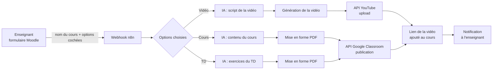

# Automatisation de contenus pédagogiques avec n8n

Présentation de mon **projet de fin d'études** : une chaîne d'automatisation **n8n** reliée à une plateforme **Moodle**. À partir du **nom d'un cours**, elle produit et publie les supports pédagogiques sans intervention manuelle.

> ℹ️ Le workflow original a été perdu. Ce dépôt est une **reconstruction de la présentation du projet** : architecture, fonctionnement et choix techniques. Il ne contient ni le workflow n8n, ni aucune clé d'API.

## Le problème

Préparer un cours demande beaucoup de travail répétitif à l'enseignant :
- rédiger le support de cours et les TD ;
- enregistrer et monter des vidéos ;
- mettre le tout en ligne, plateforme par plateforme.

## La solution

L'enseignant renseigne **un seul champ**, le nom du cours, puis **coche** les contenus qu'il veut :

| Option | Résultat |
|---|---|
| ☑️ Vidéo | Vidéo pédagogique générée, puis publiée sur **YouTube** |
| ☑️ Cours PDF | Support de cours généré en PDF, puis publié sur **Google Classroom** |
| ☑️ TD PDF | Fiche de travaux dirigés générée en PDF, puis publiée sur **Google Classroom** |

Le workflow s'occupe de tout le reste.

## Architecture

## Fonctionnement, étape par étape

1. **Déclenchement** : le formulaire envoie le nom du cours et les options cochées à un **webhook** n8n.
2. **Aiguillage** : un nœud de condition lance uniquement les branches demandées. Les branches indépendantes s'exécutent en parallèle.
3. **Génération par l'IA** : un modèle de langage produit le plan et le contenu (script de la vidéo, cours, exercices) à partir de prompts structurés.
4. **Production des fichiers** : les contenus sont mis en forme en PDF, et la vidéo est générée à partir de son script.
5. **Publication** :
   - la vidéo est envoyée sur YouTube avec l'API YouTube Data ;
   - les PDF sont publiés comme supports dans le cours Google Classroom avec l'API Classroom.
6. **Retour** : les liens produits (vidéo, documents) sont rassemblés et renvoyés à l'enseignant.

## Points techniques

- **Orchestration n8n** : webhook, nœuds de condition, branches parallèles, nœuds HTTP Request.
- **Intégration d'API REST** : authentification OAuth 2.0 auprès de Google (YouTube, Classroom) et envoi de fichiers.
- **IA générative** : prompts structurés pour obtenir un contenu cohérent et une sortie exploitable automatiquement.
- **Gestion des erreurs** : branche dédiée pour signaler un échec de génération ou de publication sans bloquer les autres contenus.
- **Sécurité** : les identifiants restent dans le gestionnaire de *credentials* de n8n et ne figurent jamais dans le workflow.

## Ce que le projet m'a appris

- Concevoir une chaîne d'automatisation complète, du besoin de l'utilisateur jusqu'à la publication.
- Faire communiquer plusieurs services par leurs API et gérer leur authentification.
- Rendre exploitable par une machine la sortie d'un modèle d'IA.

## Stack

`n8n` · `Webhooks` · `API REST` · `OAuth 2.0` · `YouTube Data API` · `Google Classroom API` · `IA générative` · `Moodle`

## Auteur

**Younesse HAMADI** – étudiant en BUT Réseaux & Télécommunications.
